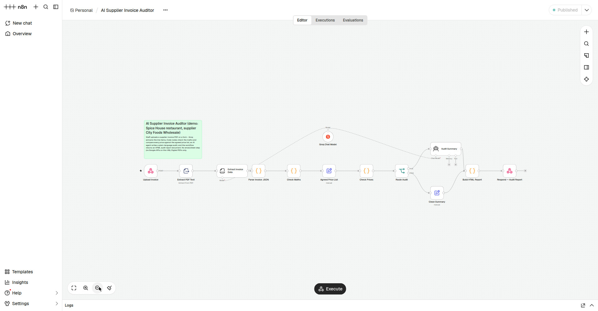

# AI Supplier Invoice Auditor

An n8n workflow that audits supplier invoices before you pay them. Staff upload the invoice PDF, the workflow re-adds every line, checks every unit price against the agreed price list, and returns a plain-language audit report — CLEAN, OVERCHARGED, or MATH ERROR.

## The problem

Supplier invoices get paid on trust. Nobody re-adds the line totals. Nobody checks the unit price against what was agreed. Tomatoes billed at $4.20 instead of $3.50, a line total that doesn't match quantity × price, the same item billed twice — it all slips through, and the money is gone before anyone looks.

An analysis of 11,000+ restaurant invoices (Supy) found at least one overcharge in 35% of invoices. An Intellyse check of 444,965 invoice lines found only 43% matched the agreed rate.

## How it works

1. **Upload Invoice** — staff upload the supplier invoice PDF (webhook, multipart form).
2. **Extract PDF Text** — the PDF is converted to text.
3. **Extract Invoice Data** — Groq (gpt-oss-120b) pulls structured data: supplier, invoice number, dates, line items, subtotal, tax, grand total.
4. **Parse Invoice JSON** — the extraction is parsed, with a salvage fallback.
5. **Check Maths** — a Code node recomputes every line total (qty × unit price), lines vs subtotal, subtotal + tax vs grand total.
6. **Agreed Price List** — the shop's agreed prices.
7. **Check Prices** — every unit price is compared against the agreed list; overcharges are computed in dollars; lines with no agreed rate are flagged.
8. **Route Audit** — clean invoices go one way, flagged ones the other.
9. **Audit Summary / Clean Summary** — an AI agent writes the findings in plain language: what was overcharged, by how much, what to dispute.
10. **Build HTML Report** — the audit report document.
11. **Respond — Audit Report** — the report comes back in seconds.

No email step, no spreadsheet step — the report is the output.

## Live test results

Tested on Spice House restaurant, supplier City Foods Wholesale. 5 out of 5 verdicts correct.

| Test | Invoice | Result |
|------|---------|--------|
| A | INV-2501 | CLEAN — $0.00 overcharge (grand $228.90) |
| B | INV-2502 | OVERCHARGED $42.00 — tomatoes 60 kg at $4.20/kg vs agreed $3.50 |
| C | INV-2503 | MATH ERROR — chicken breast stated $86.00, should be 10 kg × $6.80 = $68.00 (diff $18.00) |
| D | INV-2504 | FLAGGED — saffron $180.00, no agreed rate |
| E | INV-2505 | OVERCHARGED $87.50 — tomatoes billed twice |

## Try it

1. Import `invoice-auditor.json` into n8n.
2. Add a Groq credential and connect it to the Groq Chat Model node (model `openai/gpt-oss-120b`).
3. Activate the workflow and POST a multipart form to `/webhook/invoice-audit` with `restaurant_name` and `invoice_pdf`.
4. The HTML audit report comes back in the response.

Sample invoices are in this repo (`test-*.pdf`) — generate your own with `gen-test-pdfs.py`.

## Limits

- Reads digital PDF invoices. Scanned or photographed invoices don't work yet (the model reads text, not images).

## Built with

n8n · Groq (gpt-oss-120b) · JavaScript (Code nodes)

Part of a daily series building one real automation for small businesses, every day.
